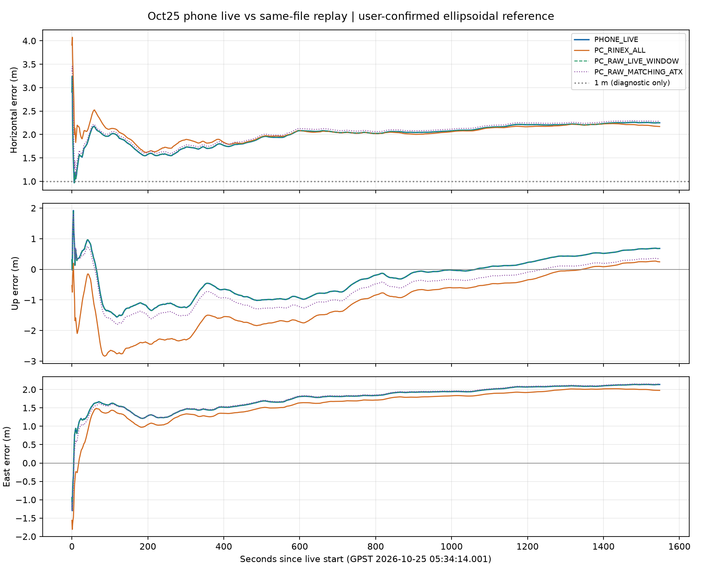

# 10/25真机实时与同文件后处理对照

本轮只处理新采集数据，不重跑旧四组，不改正式参数/源码，不安装或清理手机App。用户确认本段参考为纬度30.69820588888889°、经度104.05203827777777°、椭球高459.813m。

## 结论

1. **未发现实时JNI/观测转换/手机原生数值额外产生米级偏差。** 相同1549历元时间窗口，64345条实时观测与PC RAW回放的P/L/D/CN0/信号码/槽位/LLI全部一致；Q和使用卫星数逐历元一致。XYZ最大分量差5.819微米，ENU最大分量差6.510微米。
2. **手机已有后处理文件不完整的原因已经确定。** 系统退出记录在14:04:06给出`USER REQUESTED / FORCE STOP / SwipeUpClean`，即划掉任务导致强制停止。原`.pos`有836条完整行及一条写到一半的末行；原`.trace`约272MB。没有证据将此次中断归因于滤波崩溃、NaN或产品过期。
3. **同一套产品的完整RINEX后处理已完成1560历元。** 与手机先前已写完的836条后处理行相比，最大ECEF分量差0.093毫米，Q全部一致，支持本次PC补跑接续了相同后处理路径。
4. **米级水平偏差也出现在后处理中，并非实时端独有。** 相同实时覆盖窗口内，实时60秒后水平RMS2.024592m，RINEX后处理2.040613m；两者均没有持续60秒水平误差小于1m。后处理没有解决该段持续东偏。
5. **实时与RINEX并非相同观测输入。** 已核实4650条实时存在、RINEX未输出的相位，全部属于ADR含RESET/SLIP标志、实时携带弧段证据保留而离线直接删除；本段不是0.5/1.0m ADR不确定度门限造成这4650条差异。另外共同相位有3538条LLI不同，以及16条共同身份的伪距被离线预处理清空、2条实时身份完全不在RINEX数值记录内。这是入口规则差异，不能直接认定任一条路径正确或把坐标差全部归因于某一规则。
6. **追加且已完成ATX单因素验证，没有消除水平偏差。** 在完整RAW同一1560历元下，仅将手机37MB ATX换为现有`igs20_2438.atx`（61,579,571字节），E29标定缺失告警消失；但60秒后水平RMS由2.020359升为2.065075m，Up RMS由0.712713升为0.884968m，不能以末高程更接近真值宣称整程改善。原手机产品未替换。

## 真机与数据身份

- 设备：USB序列号`CE7X4DL7FUFIMJJ7`，Xiaomi 2407FRK8EC，包`com.example.ftpget`。
- 实时文件：`GNSS_Live/ppp_b_verified_1792906436690.*`。
- RAW：`RawData_20261025_133353.txt`；OBS：`GEOL00CHN_R_20262980533_00U_01S_MO.rnx`。
- 实时：GPST05:34:14.001～06:00:01.997，共1549历元，Q6=1546/Q5=3。
- 完整RAW/RINEX：GPST05:34:12.001～06:00:10.997，共1560历元；实时比RAW晚开始2个历元、早结束9个历元，不能直接将两者不同初值历史当作接口错误。
- 安装APK整体SHA与本地打包文件不同，但从已安装APK实际提取的两个ARM64解算库SHA与已验证本地库完全相同，配置签名均`f498c398`，`repairs=B_VERIFIED_v2`、`covariance=JOSEPH_B_MASK`、`clock_seed=PPP_COMMON`均确认。
- 手机当前记录已停止，本轮只读提取，不停止新的采集或覆盖原文件。输入逐文件SHA匹配手机，包括实际ATX，不用PC现有同名文件偷换。

## 完整对照及误差

参考坐标由用户确认用于本次误差计算，不传入SPP/PPP初始化或滤波器。本轮未独立认证参考坐标的测量框架历元及手机天线偏移。

下表**所有误差统计均取相同1549历元窗口**；完整RAW/RINEX原始输出各1560历元也保留。

|路径|窗口内Q6/Q5|60秒后水平RMS/m|60秒后Up RMS/m|末E/m|末N/m|末U/m|末水平/m|
|---|---:|---:|---:|---:|---:|---:|---:|
|手机真实实时|1546/3|2.024592|0.724003|2.136356|-0.706346|0.680564|2.250098|
|PC RAW同起止窗口|1546/3|2.024592|0.724002|2.136356|-0.706346|0.680565|2.250098|
|PC RAW完整文件|1546/3|2.020359|0.712713|2.130915|-0.712451|0.677753|2.246862|
|PC RINEX完整后处理|1546/3|2.040613|1.393504|1.976211|-0.897388|0.243700|2.170418|
|PC RAW仅换匹配ATX|1546/3|2.065075|0.884968|2.150446|-0.768995|0.349301|2.283806|

RINEX完整输出最后时刻06:00:10.997（比共同窗口末晚9秒）：纬度30.698197845°、经度104.052058856°、椭球高460.0551m；不要与窗口末点混为一个时刻。

蓝线与绿色虚线重叠，代表真实实时与同起止RAW回放。橙线为原RINEX后处理，存在额外独立预处理和稍早初始化。不是只改变某一个相位门控的单因素实验。

紫色点线是仅更换ATX的完整RAW对照。它的严格对照是PC RAW完整文件，不是稍晚开始的手机实时窗口。全1560历元最大ENU变化0.075/0.117/0.498m，末时刻ENU变化+0.0194/-0.0565/-0.3286m，Q变化0；共同窗口内水平偏差未减小。E29标定恢复不代表所有GPS L5标定补齐，新表中仍有相应L5缺项，不能称完全补齐天线模型。

## 已排除及已定位的链路问题

### 实时数值与时间链

- 相同窗口全部1549历元与64345条信号身份对应；P/L/D/CN0按现有dump精度逐值相同，槽位/信号码/LLI完全一致。
- XYZ最大分量差分别3.279、5.819、3.306微米；ENU最大差2.341、2.349、6.510微米。该量级不解释2m水平偏差。
- 手机errors.csv的ENU独立重建最大差1.32e-9m，未发现此次误差图使用另一参考点或ENU转换错误。
- 原生单历元耗时中位243.019ms、P95=361.528ms、最大489.736ms；实时窗口内没有缺失或逆序输出历元。该耗时不包含Kotlin全部文件/UI开销，现有记录未测完整端到端延迟，不能扩大为实时性能全面认证。
- 实时与同窗RAW：ARC_RESET=7787、ARC_REINITIALIZED=7475、ARC_PENDING_INIT=16336、PPP_DEGRADED=3，逐项计数一致；均没有记录PPP_FAILURE。重置计数包括多星多频/OUTAGE等，不等于7787个独立真实周跳或程序错误。

### 离线转换的实际分叉位置

以下Android源码均在`E:/android/test/FTPGet`：

- `app/src/main/cpp/gnss_jni.cpp:331`附近：实时adapter门限ADR uncertainty=1.0m。
- `app/src/main/cpp/ppp_live/rtklib/gnss_adapter.c:260`起：VALID且有限的ADR可保留相位，RESET/SLIP由pending_reset向核心传递；半周未解决写LLI_HALFC。
- `app/src/main/java/com/example/ftpget/RinexConverter.kt:836`起：离线`isAdrUsable()`直接排除ADR RESET/SLIP，门限0.5m。
- `RinexConverter.kt:340`起：半周状态变化写LLI_SLIP，持续半周未解决不按实时方式写LLI=2。
- `RinexConverter.kt:388`起：独立Doppler/MW和码跳变预处理，不是直接调用实时adapter。
- 原RINEX头部记录离线统计：REJ_CODE=4707、SLIP_DOP=4787、SLIP_MW=7、SLIP_ADR=4079。这些是离线转换统计，不能与PPP最终reject/slip或本次真实观测误判数混用。

这4650条缺相位的RAW证据在`offline_missing_phase_evidence.csv`，没有一条需要用不确定度门限差解释。3538条LLI差异中：实时0/离线1有2423条、2/0有575条、2/1有537条、3/1有3条。不能未经验证直接将某套规则替换为默认。

### 后处理不完整

系统`ApplicationExitInfo`：14:04:06.791、pid13523、reason10(USER REQUESTED)、subreason21(FORCE STOP)、`SwipeUpClean`。原文件缺少后处理成功结束，末行被截断；日志尾端处理到约05:48:27，`.pos`完整行停在05:48:06.999，这是输出缓冲尚未刷新所致，不代表05:48:07之后均无解。

Android`app/src/main/cpp/rtk_jni.c:109`附近设置tracelevel(3)，本次产生272270921字节原trace。它是额外存储/IO负担；本轮未修改，不把它当作2m偏差或本次系统强停的原因。手机后处理运行时不要划掉任务；后续可独立增加完成标记/后台任务和日志等级控制，不能把半写入`.pos`当作全程成功结果。

## 实际产品风险：时间覆盖与参考兼容须分开

本轮使用手机实际文件：

- NRT SP3/30秒CLK：`WUM0MGXNRT_20262970300`。
- RTS BIA：`WUM0MGXRTS_20262980000_01D_05M_OSB.BIA`，实际加载840条码记录。
- CODE P1D GIM、VMF3 H00/H06、手机实际`igs20.atx`及格网高程。

全部实时1549历元及后处理1560历元的轨道/钟差/IONEX/VMF3日志均IN_RANGE，未记录码OSB过期。VMF右期是GPST06:00:18，本段完整观测06:00:10.997仍在范围内。

**仍有明确的产品校准缺口，尚未证实其是本段2m偏差主因：**

- CLK声明`IGS20_2438.ATX`，手机实际37,424,166字节的`igs20.atx`不能仅凭名称视为该模型；PC检查给出`CLK_APC_UNVERIFIED_WITHOUT_BIA_DATUM`。RTS BIA没有提供完整参考声明，仍处于legacy参考分支，不能把NRT+RTS混用视为已认证。
- 实际ATX对E29缺少有效卫星标定；G03/G26/G27/G32等L5存在PCO/PCV缺项，当前legacy路径采用未标定/槽位回退。C02 C2I码OSB缺失也有legacy回退告警。
- 具体检查入口：`src/ppp_product_check.c:181`、`:469`、`:471`。Android`FtpDownloader.kt:579`和`BundledProducts.kt:16`仅使用本地/内置ATX并作结构检查，不按当前CLK声明自动更新对应版本。

因此，剩余的校准/联合状态问题在PC、手机上共同存在。不能据本次一致性证明全部物理模型正确，也没有证据通过调整R/Q/抗差阈值即可消除东偏。本轮不开展旧P0/R/GIM消融、剔星或参数搜索。

## 证据、复现与改动范围

- 证据目录：`validation/android_live_20261025_v1/`。
- `metrics.json`：共同窗口统计、首末差、耗时、断言结果；`coordinate_time_series.csv`：各路径逐历元完整ENU误差。
- `phone_exit_info.txt`、`post/trace_head_tail.txt`：强停和原文件尾证据。原手机文件未删除；没有把272MB原trace额外复制到PC。
- `phone_product_hashes.json`、`receipt.json`、`installed_native_identity.json`：原始文件/产品/安装库身份。
- `input_identity_comparison.json`、`same_window_input_control.json`、`offline_missing_phase_evidence.csv`：转换和时间窗对照。
- `pc_rinex/solution.pos`：新完成的全程1560历元后处理；`pc_txt-fast/solution.csv`为全程RAW；`pc_live_window/solution.csv`为同窗控制。
- 四次新回放（完整RAW、完整RINEX、同窗RAW、完整RAW只换ATX）均使用现有正式EXE/参数，没有构建新内核；前后52正式文件哈希校验通过。原有回归未重新运行，不能冒称本轮再次通过全部旧测试。
- 新增只读分析脚本`tests/analyze_android_live_20261025.py`，其中同窗观测精确比较、状态/卫星数、微米坐标控制、ENU重建、手机后处理前缀控制等断言全部通过。
- 只生成新输入快照、诊断脚本、报告/图和证据，不修改正式解算源码/下载模块，不调R/Q/P0/GIM/抗差参数，不提交推送。

复查统计与图：`python tests/analyze_android_live_20261025.py`。回放已完成，不因手机原后处理缺尾而再次全程运行；若将来需要复现，只使用已保存manifest并选新的输出目录，不覆盖已冻结结果。

本次最小结论是：修复实时接口或仅换ATX不是当前2m东偏的已验证方案。实时/离线观测契约必须统一或显式区分，混合偏差参考仍未完整认证；但这不等于已证明某个观测或公式是共同东偏的根因。本段后续诊断应以已经冻结的同窗RAW输入为控制，不能再重做“是否JNI导致偏差”、本次ATX单因素或后处理文件为何缺尾。**本轮定位了中断和对照失真的具体原因，没有找到能消除本段水平系统偏差的确定模型错误。**

新增本地证据已按`storage_archive.json`压缩并验证解压SHA；原手机文件、完整RAW输入和产品保留。派生的`inputs/live_window_raw.txt`已归档为`.gz`，若需复现该控制，仅恢复此文件；不要因此重新采集或重跑前面的诊断。
