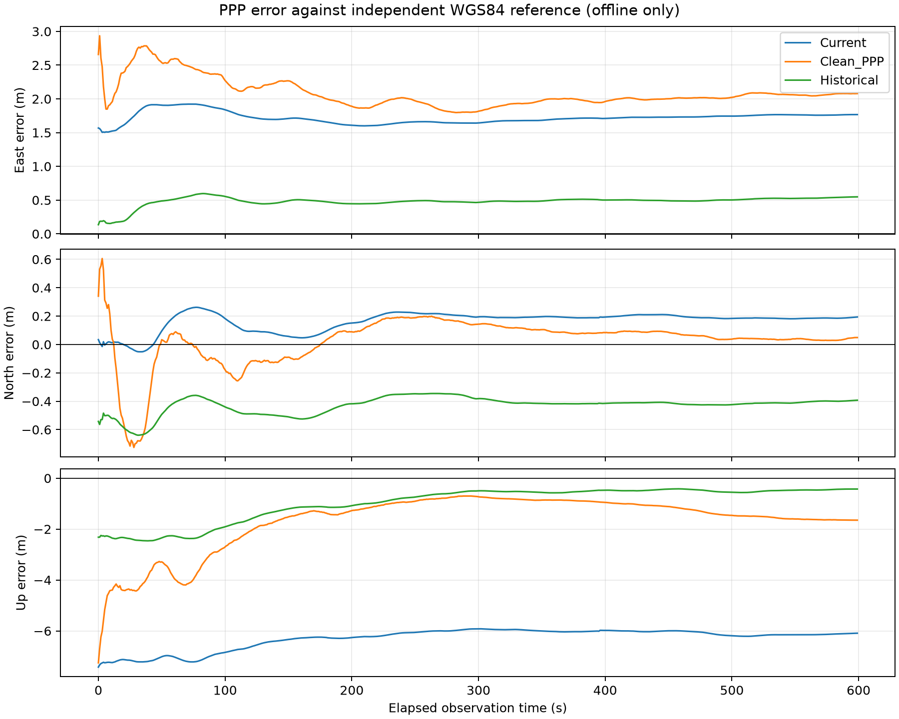

# 3 月 17 日 / 21 日 PPP 精度回归诊断

日期：2026-10-09。工作目录：`E:\GNSS\PPP_only`；开始时 HEAD：`e2de9ae`，分支 `codex/ppp-robust-ekf`。本轮生产算法参数、R/Q 配置、抗差规则、卫星筛选和默认基线均保持原值。真值只用于离线评估。

## 1. 当前结论与完成范围

**已定位新旧 3 月 21 日结果差异的主要来源：北斗 ANTEX 频率映射改变。** 在当前程序的隔离副本中，只恢复旧错误映射，末历元高程由 476.1112 m 变为 481.5996 m；该 5.4884 m 的变化占历史与当前末高程差 5.6645 m 的约 96.9%。这是同输入、同产品、同参数的代码因素实验。

旧映射把 ANTEX 频率号当成通用数组槽；北斗 C02/C07/C01 与本项目 B1I/B2/B1C 存储槽不一致。当前映射的频率身份更正确。**不能根据旧结果更接近真值就恢复错误映射；目前也不能据此声称当前卫星天线、钟差和 OSB 的整个模型已正确。** 尚待证明的是轨道参考点、钟差参考组合、OSB 的天线约定与非组合观测改正的一致性。

**同一 3/21 输入进一步用已保留的 `97a57a9` 和 `4715448` 可执行文件回放：600 条 POS 数值行及完整 STAT 均与当前默认 B 字节一致。** 数米偏差在 Phase 1 审计前基线已经存在；本例没有证据把偏差归因于 Phase 2 只读诊断或后来新增的独立 C 算法。

另一个影响已确认：B 的逐历元 IONEX 虚拟观测会显著改变位置、ZTD 和接收机码偏差的分配。它解释当前算法中的大部分模式差异，但不能把“禁用后 3 月 21 日更好”当作通用修复，因为 3 月 17 日也产生明显坐标变化。

已实质修复一个确定程序错误：缺精密钟差时 `satposs()` 将广播钟差方差写入 `*var`，错误覆盖第一颗卫星。改为 `var[i]` 并新增回退日志。两天均未触发该分支，所以此修复不会消除当前的数米精度偏差。

**大误差的历史回归来源已找到，精度问题尚未完成通用模型修复。** 本轮没有通过真值调参、加高度限制、恢复已知错误天线映射或启用新自适应来生成收敛结果。

## 2. 版本、输入与参考点

当前处理用户文件的结果 `E:\RTKLIB_Data\PPP_Result\test1.pos`、`test2.pos` 与本轮当前默认 B 回放字节一致；`test1.pos` SHA256 为 `2a452723772a37c3787ccaed199f7595f2d3cf840b5ef130b78fa778c7885f48`。因此仅换成新可执行文件不能解决这份数据的精度偏差。

| 数据 | 观测文件 | 产品类别 | 历元 |
|---|---|---|---:|
| 3/21 | `GNSS00GEO_R_20260800210_10M_01S_MO.rnx` | WUM RTS SP3/CLK/BIA，CODE PRD GIM | 600，约 10 分钟 |
| 3/17 | `K80-GNSS00GEO_R_20260760533_20M_01S_MO.rnx` | WUM FIN SP3/CLK/BIA，CODE FIN GIM | 1200，约 20 分钟 |

两个日期的时间、星空、观测质量、处理长度与产品类别不同。3/21 使用用户给定的独立天线参考点：WGS84 纬度 30.759991°、经度 103.984034°、椭球高 482.2020 m。3/17 旧报告参考值 30.759928°、103.984162°、482.253 m 尚未再次向用户核实，因此涉及它的绝对误差只作暂用统计；跨版本坐标差不依赖参考点。

输入和可执行文件哈希、状态比较、每组失败/拒绝/周跳计数见 `PPP_ACCURACY_DIAGNOSIS_EVIDENCE.json`。旧工作目录 `E:\GNSS\rtklib_only\rtklib_only` 中原有未提交工作未覆盖。

## 3. 3/21 实际误差和收敛曲线

| 算法/结果 | 有效历元 | Q6 / Q5 | 末 E / N / U（m） | 末 3D（m） | 末 60 历元 3D RMS（m） |
|---|---:|---:|---|---:|---:|
| 当前默认 B（用户 test1/test2） | 600 | 599 / 1 | +1.767 / +0.194 / −6.091 | 6.345 | 6.385 |
| 当前干净固定随机模型 A | 600 | 599 / 1 | +2.079 / +0.049 / −1.649 | 2.654 | 2.628 |
| 已复现的 9/29 历史结果 | 600 | 589 / 11 | +0.548 / −0.393 / −0.426 | 0.798 | 0.808 |
| 当前代码 + 旧错误 ANTEX 映射（仅诊断） | 600 | 599 / 1 | +0.578 / −0.349 / −0.602 | 0.905 | 0.915 |

当前 B 的末高程标准差仅 0.246 m，而实际 Up 偏差约 −6.09 m：滤波内协方差变小并未证明坐标收敛正确。Q6 仅说明载波参与的 PPP 浮点解状态，也不证明精度。



曲线直接从完整 POS 文件计算 WGS84 ECEF→ENU；包含全部 600 个输出历元，未截断启动段、平移到尾段均值、修剪异常点或限制纵轴。`Current` 是用户默认算法，`Clean_PPP` 是已有 A，`Historical` 是已复现的旧结果。切到 A 本身仍有 2.65 m 末三维误差，不能作为“问题已经解决”的证据。完整数值见 `PPP_MAR21_ACCURACY_STATS.json`。

## 4. 主要归因：ANTEX 映射 / 卫星天线模型

### 4.1 代码位置

- `src/rtkcmn.c:2582`：`readantex()`；`2628` 北斗 C02→槽0、C07→槽1、C05→槽2、C01→槽3。
- `src/preceph.c:999`：`satantoff()`；`1024` 选参考频率，`1036` 用 `off[0]/off[1]` 构造 IF PCO；`1071` `peph2pos()` 将该位移加入精密轨道坐标。
- `src/ppp.c:2573`：`satantpcv()`；`3107` PPP 各槽卫星 PCV；`1092` / `1096` `corr_meas()` 将天线改正从相位米值和伪距米值中减去。
- `src/pntpos.c:873`：启动 SPP 也使用相同精密卫星坐标，单频观测天线处理与 PPP 需要一起核实。

### 4.2 可复现因果证据

在 `validation/user_error_diagnosis/rtkcmn_old_antex_trial.c` 中仅恢复通用 `freqs[]` 索引，使用当前其余目标文件构建隔离可执行文件，未修改生产 `readantex()`。

| 同一日期、同一产品 | 当前正确频率槽映射 | 旧错误映射试验 | 高程变化 |
|---|---:|---:|---:|
| 3/21，末历元 | 476.1112 m | 481.5996 m | +5.4884 m |
| 3/17，末历元 | 482.3338 m | 482.5076 m | +0.1738 m |

3/21 的差异从启动即出现；首历元高程 474.7787→479.1651 m。3/21 最终 ZTD 2.7664→2.0766 m，表明同一个卫星模型因素在位置和对流层状态中被分配。3/17 的灵敏度明显不同，说明恢复旧映射不具备跨日期普适性。

实际 `igs20.atx` 中有效 C01 / C10 的 C02 与 C07 天线 Z 偏移均为 3.500 m、C06 为 2.770 m，且没有 C01/B1C 校准。旧索引会把 C02 放到第二槽、第一槽留零。`satantoff()` 却继续把前两槽解释成 B1I/B2 参考组合，这会生成不同且错误的参考 APC。该机制与上述隔离结果一致。

历史二进制 `gnss_replay/antex_fix_audit/legacy/gnss_replay_legacy.exe` 使用原 `ppp_321_truth_benchmark/BASELINE/command.json` 的同一 RTS 产品重放，600 条解记录（除处理耗时）与原 benchmark 完全相同；state/trace/obs/guard 文件哈希也相同。旧 0.8 m 结果可以复现，不能当作所有旧模型正确的证明。

### 4.3 仍需核实的模型边界

当前 `satantoff()` 参考组合固定为 GPS L1/L2、Galileo E1/E5b、BDS B1I/B2；ANTEX C06/B3I 当前未存入独立校准槽。不能简单将“观测的第几槽”当作“精密钟差的参考频率”。WUM RAP 或 IGS 综合 RTS 的公开参考组合信息也不能自动代替这份 WUM RTS 的定义。

当前 PPP 采用 IF-APC 几何坐标与逐信号 PCV，未明确记录逐信号 PCO 相对该参考点的差值是否已经包含在 OSB 约定中。隔离加入 `e·(PCO_signal−PCO_reference)` 后，3/21 默认 B 高程只上移 0.2195 m，3/17 也发生变化。这个简单补丁不足以解释或解决 5.5 m 的主要回归，且 BIA 缺少明确的 APC/PCC 约定字段，故未合并。

WUM CLK 标明采用 `igs20.atx`；BIA 只明确 ABSOLUTE 与采样/间隔信息，未给出足以确定 PCO 处理的字段。应同时验证轨道参考点、钟差参考组合、OSB 与天线校准来源。PRIDE 的官方使用说明也要求按钟差文件的 `SYS / PCVS APPLIED` 记录准备 ANTEX：[官方 Technical Aspects](https://github.com/PrideLab/PRIDE-PPPAR/wiki/Technical-Aspects)。该说明支持校准来源匹配要求，尚不构成本地 WUM RTS 非组合 PCO 约定的证明。

## 5. 第二影响：重复 IONEX 信息与状态耦合

代码位置：`src/ppp.c:2133` 间隔说明；`3405` 起 IONEX 虚拟行；`3498` 起 VMF3 ZWD 虚拟行。默认 B `IONCONSINT=1`，1 Hz 输入时，同一缓变 GIM 被反复以近似独立先验加入。IONEX 初始化使用的先验记账和同历元编辑原子提交已经处理，跨历元相关性仍未由该默认值表达。

在 scratch 的 `ppp_res()` 中分别跳过新 IONEX 行、VMF3 行，保留初始化、Q/R 参数、平滑、历史处罚和拒绝规则；原样 scratch 与生产 B 的 POS / STAT 哈希相同。

| 3/21 单因素试验 | 末高程（m） | 末 ZTD（m） | 末 GPS C5Q 码偏差（m） |
|---|---:|---:|---:|
| 原 B | 476.1112 | 2.7664 | −5.4285 |
| 仅无新 IONEX 行 | 479.8060 | 2.3618 | −1.3097 |
| 仅无新 VMF3 行 | 475.9082 | 2.8457 | −5.4310 |
| 两者均无新虚拟行 | 479.7749 | 2.3722 | −1.3094 |

最后 300 历元的平均坐标：仅无 IONEX 时 Up 相对原 B 增加 4.206 m。3/17 相同处理使 Up 增加 0.965 m、East 增加 1.187 m；当前观测更新路径因此改变，拒绝数也自然改变（3/21 2→5，3/17 22→17），未增加拒绝规则。

这些试验证明重复先验对当前结果有显著影响，不能单独证明 GIM 数值错误或设计最终相关大气模型。也不能按哪天误差更小来选择先验强度。ANTEX 与先验试验是不同反事实状态路径，两项米级影响不能相加当作误差分解。

## 6. 已排除或不足以解释的问题

| 检查 | 实际结果 |
|---|---|
| 已验收/历史基线同输入 | `97a57a9`、`4715448` 与当前 B 的 3/21 全部600条数值行和STAT字节一致 |
| Huber 改动 | 3/21 C 与 A 全部坐标/状态相同；64,071 条 Huber 诊断权重均为1，max abs(u)=0.325323 |
| 10 秒暖启动 | 同一当前 B、同一产品只改诊断试验启动阶段，末高程变化 −0.0378 m；未作为生产修复 |
| 3→4 处理频槽 | 当前 B 仅以 nf3 回放，末高程 475.8902 m，比 nf4 低 0.2210 m；未作为生产修复 |
| BDS C7I / C5P 的 RINEX 列顺序 | 在 3/21 副本按 3/17 顺序重排 header 与 11,211 条北斗记录；600 个数值输出与完整 STAT 字节一致 |
| NaN/Inf 假成功 | 两天四组回放失败记录0，输入/滤波失败保护44项继续通过 |
| 精密钟差回退索引 | 确有错误并修复；两天四组回退事件均0，所以无本例因果证据 |
| 单独改变 ANTEX 文件版本 | 旧二进制 RTS+igs20 换 igs20_2408，末高程仅变化 +0.09572 m；不同于读文件槽映射的代码变化 |
| FIN 与 RTS 产品切换 | 旧二进制确有数米敏感性；本次新旧 3/21 比较都使用同一 RTS，故未将产品切换认作历史回归原因 |

## 7. 本轮实质代码修复及验证

### 修改

`src/ephemeris.c:883`，`satposs()`：

- 缺精密钟差且广播钟差可用时，`var[i]=900 m²`，使用原 `STD_BRDCCLK=30 m`，未改变该参数。
- 新日志 `$SAT_CLOCK_FALLBACK` 包含原始观测历元、卫星、输入索引与方差。
- 健康卫星的方差不再因其他卫星缺钟被覆盖；未调整正常有限数据的 filter 更新。

新增 `tests/sat_clock_fallback_regression.c` / `run_sat_clock_fallback_tests.ps1`，用真实 `satposs()`、两颗卫星、11个精密轨道节点、一颗缺精密钟与广播钟回退验证，并交换输入卫星顺序。

| 验证 | 结果 |
|---|---|
| Release x64 构建 | 通过 |
| 缺钟差回退回归 | 11/11；旧源码运行同测试有4项失败 |
| Phase 1 数值/生命周期回归 | 44/44 |
| 离线精度工具校验 | 3/3：参考点原点/1m Up、Q0排除及只读、拒绝将ECEF当经纬度 |
| 3/21 A、B 修复前后 | 各600历元；POS数值行、STAT、Q、reject/slip完全一致；fallback=0 |
| 3/17 A、B 修复前后 | 各1200历元；POS数值行、STAT、Q、reject/slip完全一致；fallback=0 |
| 生产 R/Q、权重、阈值、星座筛选、默认配置 | 未改变 |

注意原 3/21 trace=2、新 trace=3；比较使用同级 trace=2 的 `$SLIP_CHECK` 等记录及完整状态文件，未把新增的 trace=3 细节当作周跳数量变化。

## 8. 后续通用修复入口与完成判据

1. 先固定实际 WUM RTS / FIN 的参考定义，建立独立于 NFREQ 观测槽的 ANTEX 频率身份与校准可用性检查；从轨道坐标→参考 APC→实际 signal 改正→OSB 逐项证明不重算或漏算。
2. 用手工几何、零/相同 PCO、参考 IF 组合抵消和缺失校准测试验证天线模型；SPP 与 PPP 共用已明确的参考定义。不能从坐标真值挑参考组合。
3. 把 B 历史大气先验保留为可复现行为；新固定 PPP 基础需单独说明外部慢变先验的信息使用方式。新增相关大气模型属于独立算法变更，当前尚未实现。
4. 同时验证 3/17、3/21、已有 TXT 输入与人工故障。验收应覆盖模型正确、失败保护、行为可追溯与跨数据一致性；10分钟结果接近真值不单独证明普适性。
5. 完成上述模型检查后再进入普通抗差或自适应滤波。当前没有增加 Huber、IGG、eta 或 Q/R 自适应。

本轮已提供明确的回归来源、两天隔离证据和一个确定索引修复；剩余模型问题继续保留，不将新构建描述为“3/21精度问题已解决”。

## 9. 复现与文件

- 生产程序：`E:\GNSS\PPP_only\x64\Release\PPP_only.exe`。
- 修复前程序快照：`validation/user_error_diagnosis/PPP_only_before_clock_index_fix.exe`。
- 正常回放：`validation/user_error_diagnosis/mar{17,21}_{A,B}_clockfix.pos`、对应 TRACE / STAT。
- IONEX/VMF3 隔离：`validation/atmos_prior_ablation/summary.json`、scratch源码/编译命令/输出。
- 历史复现：`validation/historical_replay/legacy_exe_5baa7f21`。
- 通用离线精度工具：`tests/audit_ppp_accuracy.py`，仅读输出文件，支持自定真值、结果标签、成对比较和可选 matplotlib 图；无滤波调用。

示例（真值只进入离线工具）：

```powershell
python tests/audit_ppp_accuracy.py --truth 30.759991 103.984034 482.2020 --pos "result=E:/RTKLIB_Data/PPP_Result/test1.pos" --json-out accuracy.json
./tests/run_sat_clock_fallback_tests.ps1
./tests/run_phase1_tests.ps1
python tests/test_accuracy_audit.py
```

`validation/` 不进入版本控制。报告与小型证据 JSON 入库；原始观测、产品和大体积日志保留在本地。证据中的 A/B 标识用于科研回归追踪，日常复现用户本次问题的基准是实际默认算法及 `test1.pos`。
