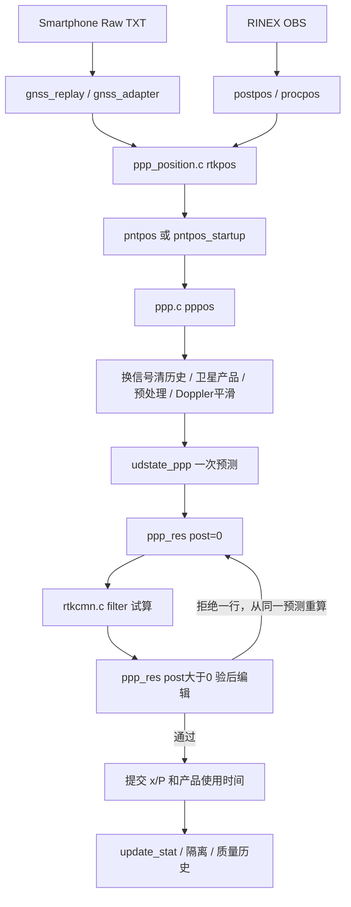

# PPP 实际调用链审计

审计日期：2026-10-08。对象：`E:/GNSS/PPP_only`，审计前提交 `97a57a92552d6d7efe7c855c82b9809e28a5bd17`。本文行号指该提交源码；本轮没有修改生产代码。

## 1. 当前可编译核心

解决方案 `PPP_only.sln` 编译的是 `PPP_only/ppp_position.c` 中的 `rtkpos()`，不是原复制工程中完整的 `src/rtkpos.c`。构建清单见 `PPP_only/PPP_only.vcxproj`。SPP 是 PPP 粗位置/钟差初始化的依赖，不是另一个被默认运行的最终定位模式。

## 2. Smartphone TXT 入口

| 步骤 | 文件、函数、行号 | 实际行为 |
|---|---|---|
| PC 主入口 | `src/rnx2rtkp.c:151` `main`；337、449–450 | 应用共用配置；TXT 选择界面或无窗口回放 |
| 桥接 | `src/pc_txt_replay.c:8` `pc_txt_replay_observed`；51 | 构造 TXT/product 参数，强制 `ppp-safe` 与 ADR uncertainty 门限；调用 `gnss_replay_run_observed` |
| GUI 路径 | `src/pc_live_view.c:45` `replay_worker` | 同一回放桥接，显示不另开滤波器 |
| 会话 | `src/gnss_replay.c:957` `gnss_replay_run_observed`；1044 | 会话开始一次 `rtkinit`，持续同一 `rtk_t` |
| TXT 解码 | `src/gnss_replay.c:224` `parse_raw`；258 `normalize_clock`；883 `process_txt_epoch` | 还原 `android_clock_t/android_meas_t`，按历元处理；1x 回放仅改变释放时刻 |
| 适配 | `src/gnss_replay.c:938` → `src/gnss_adapter.c:125` `gnss_adapter_convert` | 生成 RTKLIB `obsd_t`；SNR 毫 dB-Hz、L 周、P 米、D Hz |
| 每历元求解 | `src/gnss_replay.c:780` `solve_obs_epoch`；819 | 一次 `rtkpos(rtk,obs,nobs,nav)`；“一次调用”不代表内部只做一次编辑试算 |

## 3. RINEX 入口

`src/rnx2rtkp.c:493 main -> src/postpos.c:1529 postpos -> :1428 execses_b -> :1377 execses_r -> :1176 execses`。

数据读取支路：`execses -> :840 readobsnav -> :871 readrnxt -> src/rinex.c:1727 readrnxt`。会话支路：`execses :1310 rtkinit -> :510 procpos -> :531 inputobs -> :546 rtkpos`。默认 `SOLTYPE_FORWARD`；后向/组合分支仍存在于 `postpos.c:1340–1348`，不能把这些输出用于声称因果实时的实验。

两个 PC 入口最终进入相同的 `rtkpos/pppos`。**输入不保证相同**：TXT `ppp-safe` 白名单在 `gnss_signal_policy.c:4–23`，不包含 B1C；RINEX `code2idx` 路径可把 B1C 放入第四槽（`rtkcmn.c:689`），PPP 有对应 RCB（`ppp.c:259–260`）。所以同一配置签名不代表采用相同信号。

## 4. PPP 主调用链和提交点

| 顺序 | 文件、函数、行号 | 状态变化及注意事项 |
|---|---|---|
| 1 | `PPP_only/ppp_position.c:238 rtkpos`，247、249、272–312 | 模式检查；启用 STARTQC 时才做输入清洗；SPP 求粗解，已有 PPP 时允许 SPP 失败后继续；tt 根据 sol.time 更新 |
| 2 | `PPP_only/ppp_position.c:320` → `src/ppp.c:3653 pppos` | 核心入口 |
| 3 | `ppp.c:3685 prepare_signal_quality_ppp`；3687 `satposs`；3696–3703 | 换 signal 清旧弧历史；产品计算；LLI/GF/Doppler/MW/启动码检查；平滑与 warmup 各一次 |
| 4 | `ppp.c:3711` → `:2403 udstate_ppp` | 顺序：udpos(2408)、udclk(2411)、udtrop(2415)、udiono(2419)、uddcb(2423)、udbias(2426)。直接更新 rtk->x/P 为预测起点，不是试算副本 |
| 5 | `ppp.c:3796–3802` → `:2781 ppp_res(post=0)` | 每轮复制同一预测 x/P；构造 v(nx 无关的 nv 行)、H(nx×nv，列主序)、R(nv×nv)；混合 R0、历史处罚、当前残差降权、虚拟先验 |
| 6 | `ppp.c:3808` → `rtkcmn.c:1479 filter` → `:1459 filter_` | 活跃状态压缩，形成 S=HᵀPH+R；只检查矩阵逆返回值；P 更新为简式，不是 Joseph |
| 7 | `ppp.c:3815` → `ppp_res(post=i+1)` | 使用试算 xp 重算真实 GNSS 验后残差，不加入大气虚拟行；z0>8 候选中拒绝一行，设置 mexc，继续试算，最多16轮 |
| 8 | `ppp.c:3825–3833` | 验后通过才提交 xp/Pp 和先验使用时间；首次验后 diag 另存 evidence，3821 |
| 9 | `ppp.c:3880` → `:3550 update_stat` | 复制位置/协方差/钟差到 sol；任意频率有效载波卫星不足4时 Q0，足够码行时3888–3903降级Q5 |
| 10 | `ppp.c:3881,3916–3922` | 隔离、CMC 和首次验后残差质量历史；诊断输出；释放本历元临时内存 |

AR 调用 `ppp.c:3865–3867` 当前默认关闭；`src/ppp_ar.c:18–21` 实现直接返回0，不能声称已经实现 PPP-AR。

## 5. 失败路径

`ppp.c:3802–3810` 无方程/逆矩阵失败，或16轮仍不通过：不提交 xp/Pp；`rtk->x/P` 已保留本历元预测。默认 outsingle=0 时外层316先置 Q0，故通常不伪装成有效Q6。`rtkpos:340` 仍返回1，调用者必须读 `sol.stat`。

但是 `filter` 可能对 NaN 新息返回0，而验后 NaN 比较不触发拒绝；当前没有非有限后验和协方差有效性检查。详见审计 C-01。失败时 `sol.rr/qr` 可能仍是 SPP/旧字段，Q0 行必须作无效处理；不能仅看坐标列或函数返回值。`outsingle=1` 会输出有效SPP回退，实验应另记来源。

## 6. Android GnssMeasurementsEvent / JNI

用户明确要求本阶段先忽略 Android 工程。本仓库没有 Java/Kotlin/JNI native entry 或 Android 构建清单；`gnss_raw.h/gnss_adapter.c` 的 Android 数据结构只证明 PC TXT 的适配器，不证明手机 JNI 使用同一编译核心。**本阶段未核实 Android 路径，不作“三入口已一致”结论**。下一阶段需核实 native 源码清单、NFREQ/MAXSAT、默认配置、clock/ADR 标志和同次采集的 adopted-observation/state 对照。

完整发现、与开题报告关系和基线设计见 [BASELINE_AUDIT.md](BASELINE_AUDIT.md)。
